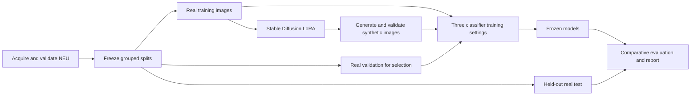

# High-Fidelity Synthetic Defect Generation for Industrial Visual Inspection

**In development. Data tooling and the real-only classifier are under review. Real NEU experiment results are pending.**

This three-week university project will investigate whether LoRA-adapted latent diffusion can produce useful industrial surface defect images. We will compare real-only, synthetic-only and real + synthetic classifier training on one held-out real test set. Improvement is a hypothesis, not a promised outcome.

[Documentation](docs/README.md) · [Architecture](docs/architecture/overview.md) · [Implementation plan](docs/planning/implementation-plan.md) · [Backlog](docs/planning/backlog.md) · [Roadmap](docs/planning/roadmap.md) · [Protocol](docs/experiments/protocol.md) · [Contributing](CONTRIBUTING.md)

## Motivation and objectives

Rare industrial defects are expensive to collect and annotate. Our objectives are reproducible data preparation, pretrained Stable Diffusion adaptation with LoRA, modest synthetic generation, and a fair downstream comparison. The [proposal](GenAI%20Project%20Proposal.pdf) draws inspiration from SynSur; this project is a simplified classification study, not a reproduction of its detection system.

NEU-CLS has 1,800 grayscale 200 × 200 images, 300 per class: crazing, inclusion, patches, pitted surface, rolled-in scale and scratches. It is balanced, so our main experiment studies a small balanced benchmark. A rare-class/scarcity ablation would be a separately approved extension.

## Proposed solution and pipeline



Recommended baseline: SD v1.5 at 512 px, one class-prompt-conditioned UNet LoRA, and ResNet-18 at 224 px. Replicate grayscale across RGB channels for pretrained compatibility. Inpainting and EfficientNet-B0 are optional. The planned stages are acquisition, validation, splitting, preprocessing, model preparation, LoRA, generation, quality review, classifier training, evaluation and reporting.

## Technology stack

| Layer | Proposed tools |
| --- | --- |
| Data | Pillow, NumPy, pandas, scikit-learn |
| Generation | PyTorch, Diffusers, PEFT, Accelerate, Transformers |
| Classification | PyTorch and torchvision |
| Evaluation | scikit-learn, matplotlib, TorchMetrics/torch-fidelity |
| Tracking | Local JSON/CSV/YAML, hashes and Git |
| Foundation checks | Ruff, PyYAML, GitHub Actions |

## Experimental methodology and planned results

Proposed grouped, stratified split: 70/15/15 (nominally 1,260/270/270). Only training images may train the generator. All classifier arms share initialization policy, transforms, class balance, optimizer-update budget, validation selection and test manifest. Target 600 accepted synthetic images, subject to a 1,000-candidate compute cap; report actual counts and rejection rates.

Report accuracy, macro precision/recall/F1, per-class metrics and confusion matrices. Visually review generated defects and measure exploratory KID against real validation images. The proposal leaves its quantitative quality metric unfinished; KID is a recommendation with small-sample/domain limitations. Synthetic-only describes classifier inputs: its generator still learns from real images. See the [protocol](docs/experiments/protocol.md) and empty [results template](reports/results-template.md).

## Three-week roadmap

| Week | Deliverable | Integration gate |
| --- | --- | --- |
| 1 | Provenance, splits, preprocessing, baseline, GPU feasibility | Shared manifest contract consumed by both ML streams |
| 2 | LoRA, generation, provenance and quality review | Small end-to-end synthetic classifier run |
| 3 | Three-arm comparison, reporting, reproducibility audit | Freeze configurations before opening test results |

See [schedule and ownership](docs/planning/roadmap.md) for effort, critical path and fallback gates.

## Repository structure

```text
.github/                 CI, contribution templates and ownership guidance
configs/                 Proposed parameters and experiment-record template
data/                    Provenance and storage instructions; no dataset
docs/architecture/       Module contracts and decision records
docs/research/           Feasibility, references and licensing ledger
docs/planning/           Stage plan, 20 issue drafts, schedule and risks
docs/experiments/        Experiment protocol
src/industrial_defect_diffusion/  Empty package and module boundaries
tests/                   Future testing strategy
scripts/                 CPU-only foundation validator
reports/                 Results template and verification record
```

## Setup and planned execution

Prerequisites: Python 3.11, Git and a terminal. The foundation installs no PyTorch or model weights. See the [environment guide](docs/planning/setup.md) for the separate CPU ML setup and pending university GPU verification.

```powershell
python -m venv .venv
.venv\Scripts\python -m pip install -e ".[dev]"
.venv\Scripts\python scripts/check_foundation.py
.venv\Scripts\python -m ruff check .
.venv\Scripts\python -m ruff format --check .
```

On Linux/macOS use `.venv/bin/python`. Installation requires package-index access. See the [environment guide](docs/planning/setup.md), [experiment settings and run records](docs/experiments/configuration.md), and the [real-only baseline guide](docs/experiments/real-baseline.md). For generation, follow the [LoRA training guide](docs/experiments/lora-training.md) and [candidate generation guide](docs/experiments/generate-candidates.md). Real generation awaits the university pilot and a reviewed adapter.

## Collaboration and team

Muhammad Zohaib · Muhammad Saad Salman · Muhammad Hasnain. Instructor: Dr. Usman Ali.

Workstreams A (data), B (generation), C (classification/evaluation) are suggestions, not assignments. GitHub usernames remain unconfirmed. Follow [CONTRIBUTING](CONTRIBUTING.md), [Definition of Done](docs/planning/definition-of-done.md) and [AGENTS.md](AGENTS.md). Keep `main` stable; use short-lived branches and one peer-reviewed PR per focused change.

## References and limitations

- Kühn et al. (2026), [SynSur v2](https://arxiv.org/abs/2604.26633v2): inspiration; its FLUX/detection pipeline differs from ours.
- Rombach et al. (CVPR 2022), [Latent Diffusion Models](https://arxiv.org/abs/2112.10752): latent-space diffusion foundation.
- Song and Yan, [official NEU page](https://faculty.neu.edu.cn/songkc/en/zdylm/263265/).

See [feasibility](docs/research/feasibility.md) and [source ledger](docs/research/references.md). Limited GPU time, overfitting, incorrect prompt labels, small test sets and natural-image metric bias may limit conclusions. No production deployment or detection/segmentation benchmark is planned.

## License

Original source code uses [MIT](LICENSE), approved by the requester on 2026-11-04. Dataset, pretrained weights, generated artifacts and third-party proposal content have separate terms. See the [license ledger](docs/research/licensing.md); do not assume public download means redistribution is permitted.

