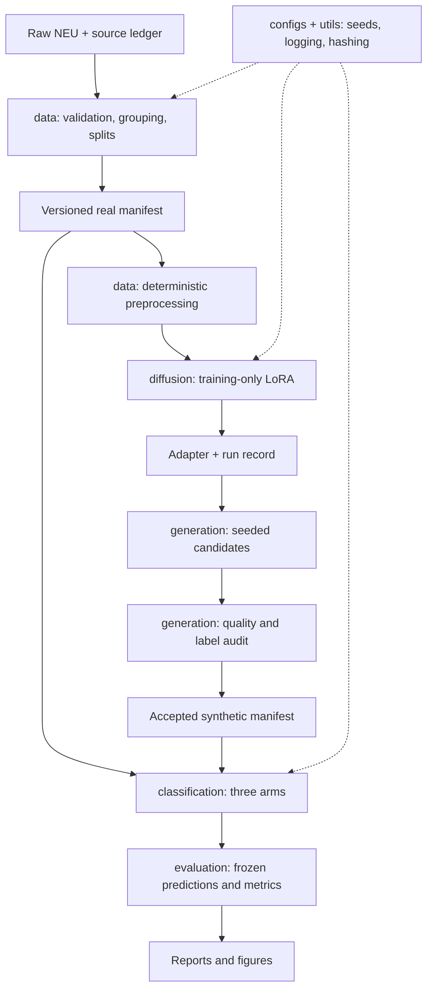

# Architecture — PLANNED

Use a small Python package with explicit file contracts, not a service architecture. Each stage reads immutable manifests/configuration and writes versioned artifacts. No module implementation exists yet.

| Boundary | Owns | Must not own |
| --- | --- | --- |
| `data` | Acquisition metadata, decode validation, grouping, split manifests, transforms | Training or model selection |
| `diffusion` | Model loading, adapter training, checkpoint metadata | Editing splits or accessing test pixels |
| `generation` | Prompt catalog, sampling, provenance, quality decisions | Reassigning uncertain labels silently |
| `classification` | Shared classifier training and arm-specific data sampler | Computing final test-driven hyperparameters |
| `evaluation` | Predictions, metrics, plots, generation-quality analysis | Retraining after viewing test outcomes |
| `utils` | Seeds, hashes, logging and run-record helpers | Hidden global state or research policy |
| `configs` | Versioned explicit parameters | Credentials or machine-specific paths |

Library functions accept parsed configuration and manifest paths; thin CLI/orchestration layers will handle arguments. Do not build a generic plugin framework. Notebooks may explore already validated data, but reusable logic belongs in the package. [Contracts](contracts.md), [ADRs](decisions.md), [stage plan](../planning/implementation-plan.md) define implementation boundaries.
